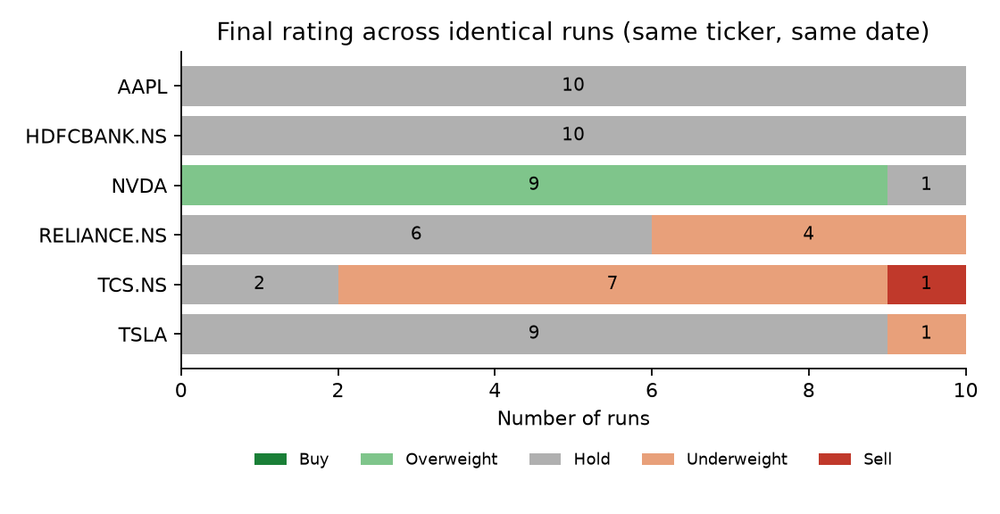

# How consistent is a multi-agent LLM trading system? A run-to-run experiment on TradingAgents

**Question.** [TradingAgents](https://github.com/TauricResearch/TradingAgents) ([paper](https://arxiv.org/abs/2412.20138)) is a team of LLM agents (analysts, bull/bear researchers, trader, risk debaters, portfolio manager) that outputs a trading rating. If you give it the *same ticker on the same date* repeatedly, does it give the same answer?

This is a reliability study, not a backtest. It makes **no claim about trading performance**.

## Method

- 6 tickers (NVDA, AAPL, TSLA, RELIANCE.NS, HDFCBANK.NS, TCS.NS), one analysis date (2026-10-01), **10 independent runs each = 60 runs**.
- Models: `gemini-3.5-flash-lite` (deep-thinking role) and `gemini-3.1-flash-lite` (quick role), free tier.
- Config: market (technical) analyst only, 1 debate round, 1 risk-discussion round. Everything else is the framework default.
- Each run uses a **fresh decision-log file**. By default TradingAgents feeds earlier decisions on the same ticker into the Portfolio Manager's prompt, which would make runs dependent on each other. Runs here are independent.
- Harness: [`run_experiment.py`](run_experiment.py) (resumable, logs every run to `experiment/results.csv`, saves full reports in `experiment/runs/`). Analysis: [`analyze.py`](analyze.py).
- Metrics: rating counts, modal agreement (share of runs equal to the most common rating), share of run pairs that disagree, bullish↔bearish flips, and the Trader's stop-loss distance from the close.

Reproduce: `python run_experiment.py --tickers NVDA AAPL TSLA RELIANCE.NS HDFCBANK.NS TCS.NS --runs 10 --deep gemini-3.5-flash-lite --quick gemini-3.1-flash-lite`, then `python analyze.py`.

## Results

| Ticker | Ratings (10 runs) | Agreement with most common rating |
|---|---|---|
| AAPL | Hold ×10 | 100% |
| HDFCBANK.NS | Hold ×10 | 100% |
| NVDA | Overweight ×9, Hold ×1 | 90% |
| TSLA | Hold ×9, Underweight ×1 | 90% |
| TCS.NS | Underweight ×7, Hold ×2, Sell ×1 | 70% |
| RELIANCE.NS | Hold ×6, Underweight ×4 | 60% |

- **Overall, 85% of runs (51/60) match their ticker's most common rating.** 24% of run pairs (65/270) disagree.
- **No run pair flipped from bullish (Buy/Overweight) to bearish (Underweight/Sell).** Disagreements are mostly one step around Hold. The widest case is TCS.NS, which produced one Sell among mostly Underweights.
- **Consistency depends heavily on the stock**, from 100% (AAPL, HDFCBANK.NS) to 60% (RELIANCE.NS). I did not test why. A tempting story is "stocks near a rating boundary flip more", but TSLA was stable, so the data does not clearly support a single mechanism.
- **Stop-loss levels are noisy.** The Trader's stop averages roughly 2.6–7.1% from the close depending on ticker. NVDA is the widest, ranging from 4.4% to 13.3% across 10 runs (sd 2.5 points). See [`experiment/summary.md`](experiment/summary.md) for all tickers.
- **The Portfolio Manager rarely gives a price target.** It is missing in 57 of 60 runs, and the stop-loss is sometimes "not provided" (so stop statistics use fewer than 10 runs for some tickers; `n` is in the summary table).

## Caveats (read these before citing the numbers)

- **One date, six tickers, N=10.** Rates like 90% vs 100% are not statistically distinguishable at this size. Treat the ordering of tickers as suggestive.
- **Cheap models, reduced pipeline.** Flash-Lite models and a single (technical) analyst, so there is no news, sentiment or fundamentals input. A stronger model or fuller pipeline could be more or less consistent. This study does not say.
- **Possible training-data contamination.** Backtests of LLM agents on past dates can leak knowledge from the models' training data. The analysis date here is recent, but I have not verified that it falls after the models' training cutoff, so this is unconfirmed.
- **Market data was not byte-identical for two tickers.** Runs were fetched over several weeks, and Yahoo's data for the analysis date shifted slightly for the two Indian tickers: RELIANCE.NS RSI is 27.92 in runs 1–4 and 28.15 in runs 5–10, and HDFCBANK.NS RSI is 49.31 in runs 1, 2 and 4 and 49.20 in the others. The other four tickers had the same indicator values in all 10 runs. RELIANCE still flipped *within* each data batch (runs 1–4: 2 Underweight, 2 Hold; runs 5–10: 2 Underweight, 4 Hold), so its disagreement is not explained by the data shift, and HDFCBANK was Hold throughout. Still, strictly "identical input" applies cleanly to NVDA, AAPL, TSLA and TCS.NS.
- **Parsing.** Ratings, stops and horizons are extracted from free text with regexes. Three rows were spot-checked against the saved reports and matched, but not every row was.
- **Not a performance claim.** Consistency is not accuracy: a system can be reliably wrong. The original paper's headline Sharpe ratio comes from a short backtest on large tech stocks and should not be taken as evidence of real-world returns.

## What I'd do next

Add more dates and the news/fundamentals analysts, compare a stronger model at the same N, and score the ratings against realised forward returns with proper out-of-sample dates.
